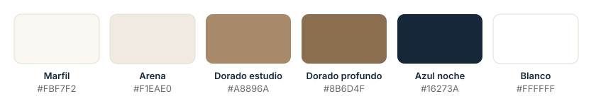

<p align="center">
  
</p>

<h1 align="center">MAS — Estudio Jurídico</h1>

<p align="center">
  Landing institucional del <strong>Estudio Jurídico Modugno &amp; Alvarez Schiaffino</strong>.<br />
  Seria, clara y pensada para que cada visita termine en una consulta por WhatsApp.
</p>

<p align="center">
  <a href="https://www.estudiojuridicomas.com.ar">estudiojuridicomas.com.ar</a> ·
  <a href="#secciones">Secciones</a> ·
  <a href="#características">Características</a> ·
  <a href="#cómo-editar-el-contenido">Editar contenido</a> ·
  <a href="#desarrollo">Desarrollo</a>
</p>

---


## Sobre el proyecto

One-pager para un estudio jurídico boutique con dos socios. El objetivo es
transmitir **seriedad, formalidad y confianza** sin perder un aire moderno.
Todos los caminos del sitio llevan a **WhatsApp**: no hay formularios ni
backend de envío de mails, solo enlaces directos a WhatsApp y al email.

|                |                                                              |
| :------------- | :----------------------------------------------------------- |
| **Cliente**    | Estudio Jurídico Modugno & Alvarez Schiaffino (marca: *MAS*) |
| **Tipo**       | Landing de una página, estática                              |
| **Stack**      | Astro 7 · TypeScript · CSS puro · pnpm                       |
| **Hosting**    | Vercel                                                       |
| **Contenido**  | Centralizado en `src/data/DataSite.ts`                       |

## Características

### WhatsApp primero
- Botón flotante persistente y CTAs en el hero, en servicios y en contacto.
- Mensaje prellenado configurable (`contact.defaultWhatsappMessage`).
- Links generados desde un único helper (`src/utils/contact.ts`).

### Rendimiento
- Sitio 100% estático: el HTML sale listo del build, sin frameworks de UI en
  el cliente.
- Imágenes optimizadas con `<Image />` de Astro (WebP, `srcset` por ancho,
  lazy loading fuera del primer pantallazo y `fetchpriority="high"` en el hero).
- Fuentes **Inter** y **Playfair Display** servidas desde el propio dominio
  con la API de fonts de Astro, en versión variable y con preload.
- Los `<script>` de las secciones no importan módulos, así Astro los deja
  inline y no suma pedidos extra.

### Accesibilidad
- Link "Saltar al contenido", landmarks y encabezados jerárquicos.
- Carruseles navegables con teclado, con `aria-roledescription` y botón de
  pausa.
- Respeto de `prefers-reduced-motion` en todas las animaciones.
- Aviso para lectores de pantalla en los enlaces que abren otra pestaña.

### SEO
- `title` y `description` con la zona de atención, URL canónica y `lang="es-AR"`.
- Open Graph y Twitter Cards con imagen opaca de 1200×630 (`public/og-image.jpg`).
- Datos estructurados **JSON-LD** (`LegalService` + `WebSite`) con áreas de
  práctica, profesionales, zona y horario (`src/utils/structuredData.ts`).
- `sitemap.xml` y `robots.txt` generados en el build (`src/pages/`).

> La ubicación y el horario existen **solo para buscadores** (JSON-LD y
> metadatos). Por decisión del cliente, no se muestran en la página.

## Diseño

<p align="center">
  
</p>

| Uso              | Tipografía                                      |
| :--------------- | :---------------------------------------------- |
| Títulos          | **Playfair Display** (500–600), serif editorial |
| Texto e interfaz | **Inter** (400–700), sans-serif legible         |

- Los tokens de color, espaciado, radios y sombras están en `:root` de
  `src/styles/Style.css`.
- Mobile-first, con breakpoints de referencia en `480px`, `768px`, `1024px` y `1280px`.
- El logo y el isotipo viven en `src/assets/brand/`. Los favicons se
  generaron a partir del isotipo.

Más detalle en [`docs/01-diseno-y-marca.md`](./docs/01-diseno-y-marca.md).

## Cómo editar el contenido

Los componentes no tienen textos escritos. Todo el copy, los datos de
contacto y los metadatos están en **`src/data/DataSite.ts`**:

| Clave                                       | Qué controla                                       |
| :------------------------------------------ | :------------------------------------------------- |
| `brand`                                     | Nombre corto y nombre legal                        |
| `contact`                                   | Email, teléfono, número de WhatsApp y mensaje      |
| `navbar.links`                              | Enlaces del menú                                   |
| `hero`                                      | Título, bajada y textos de los botones             |
| `practiceAreas` / `practiceAreasSection`    | Tarjetas de servicios (título, descripción, ícono) |
| `about.partners`                            | Socios: nombre, rol, bio y foto                    |
| `testimonials`                              | Reseñas (nombre, texto, estrellas)                 |
| `contactSection` / `footer`                 | Textos de cierre y leyenda legal                   |
| `seo`                                       | Title, description, imagen OG, ubicación y horario |

Las fotos nuevas van en `src/assets/` y se importan en `DataSite.ts` para
que Astro las optimice. Los íconos de servicios son de
[Lucide](https://lucide.dev) (`lucide-static`).

## Desarrollo

**Requisitos:** Node.js `>= 22.12` y pnpm.

| Comando         | Acción                                                |
| :-------------- | :---------------------------------------------------- |
| `pnpm install`  | Instala las dependencias                              |
| `pnpm dev`      | Servidor de desarrollo en `localhost:4321`            |
| `pnpm build`    | Genera el sitio de producción en `.vercel/output/`    |
| `pnpm preview`  | Previsualiza el build local                           |

### Estructura

```text
/
├── docs/                    # especificación del proyecto (marca, copy, roadmap)
│   └── readme/              # capturas y gráficos de este README
├── public/                  # favicons e imagen de Open Graph (rutas fijas)
└── src/
    ├── assets/              # imágenes que pasan por el optimizador de Astro
    │   ├── brand/           # logo e isotipo
    │   ├── hero/            # fondo del hero
    │   └── partners/        # fotos de los socios
    ├── components/          # Atomic Design
    │   ├── atoms/           # Icon, StarRating, WhatsAppIcon, NewTabNotice
    │   ├── molecules/       # ServiceCard, PartnerCard, TestimonialCard, NavLink…
    │   ├── organisms/       # Navbar, Hero, Servicios, Nosotros, Reseñas, Contacto, Footer
    │   └── templates/       # MainLayout (head, SEO, JSON-LD)
    ├── data/DataSite.ts     # todo el contenido del sitio
    ├── pages/
    │   ├── index.astro      # la landing
    │   ├── robots.txt.ts    # robots.txt generado en el build
    │   └── sitemap.xml.ts   # sitemap generado en el build
    ├── styles/Style.css     # hoja global con los tokens de diseño
    └── utils/               # links de contacto y datos estructurados
```

### Deploy

El sitio se publica en **Vercel** con `@astrojs/vercel`. Cada push a
`master` dispara un deploy de producción. El dominio está definido en
`site` (`astro.config.mjs`), y de ahí salen la URL canónica, el sitemap y el
JSON-LD.

## Documentación

La especificación completa está en [`docs/`](./docs):

| Archivo | Contenido |
| :------ | :-------- |
| [`00-overview.md`](./docs/00-overview.md) | Resumen del proyecto y del cliente |
| [`01-diseno-y-marca.md`](./docs/01-diseno-y-marca.md) | Paleta, tipografía, logo y tono de marca |
| [`02-contenido-copy.md`](./docs/02-contenido-copy.md) | Copy de cada sección |
| [`03-estructura-tecnica.md`](./docs/03-estructura-tecnica.md) | Estructura, `DataSite.ts`, WhatsApp, SEO |
| [`04-plan-implementacion.md`](./docs/04-plan-implementacion.md) | Plan de implementación |
| [`roadmap.md`](./docs/roadmap.md) | Fases de desarrollo y criterios de aceptación |

---

<p align="center"><sub>© 2026 Estudio Jurídico Modugno &amp; Alvarez Schiaffino. Todos los derechos reservados.</sub></p>
